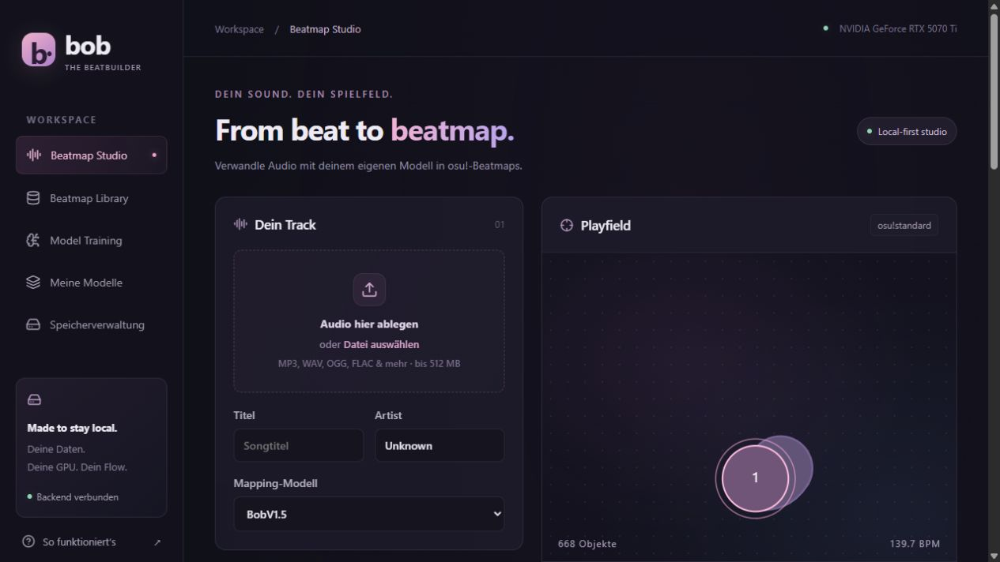
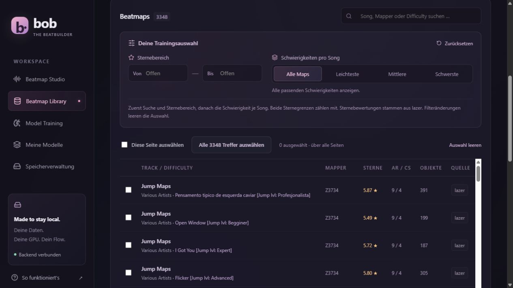
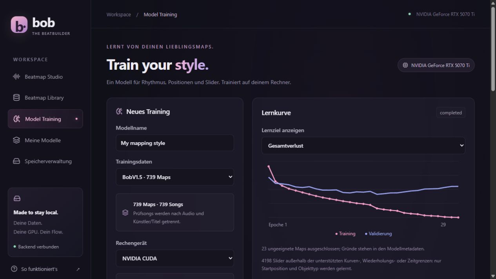
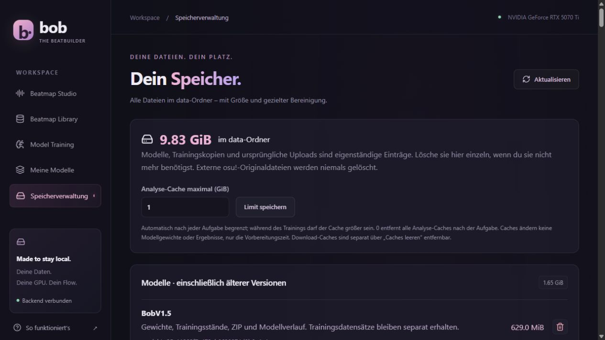

# BobTheBeatbuilder

**Train your own osu! mapper. Keep your music, models, and training local.**

BobTheBeatbuilder is a local web app for training an audio-conditioned model on existing **osu!standard** beatmaps and generating new maps from music. It combines React, a Python/PyTorch backend, and a C# reader for osu!lazer libraries.

```text
Beatmaps + audio → curated dataset → train one model → new audio → .osz draft
```



> **Experimental:** generated maps are drafts that need review and playtesting. Lower validation loss does not guarantee enjoyable mapping. No pretrained model or music collection is included. The interface currently mixes German and English; screenshots show the actual UI.

## Features

- Import from **osu!lazer**, stable Songs folders, or `.osz`/`.zip` archives.
- Search, star-range filters, cross-page selection, and **one difficulty per song**: easiest, middle, or hardest.
- Local training on **CUDA, DirectML, or CPU**, with learning curves, validation, throughput, and GPU memory statistics.
- A single model for rhythm, a compact phrase plan, and movement, using extended audio context and autoregressive object history.
- **Target star rating**: every training map gets its official star rating (aim, speed, reading) from the same `ppy.osu.Game.Rulesets.Osu` library lazer uses; generated maps are measured the same way and can be re-generated until they land within ±0.15 ★.
- **Mapper styles**: guest difficulties are credited to the guest mapper ("NiNo's Insane" in a Sotarks set counts for NiNo); mappers with enough maps get a learned embedding plus a measured style profile.
- **Pattern controls**: bursts, streams, stream length and spacing, 1/2 jump distance, sharp vs. linear angles, stacks, slider share/velocity/kick sliders, combo length, aim/speed balance. The decoder chooses the rhythm itself on the beat grid, so triples, bursts, streams and 1/2 jump sections are learned as sequences.
- Generation controls for AR, CS, OD, HP, density, slider preference, spacing, directional flow, variation, and timing.
- Audio/playfield preview, volume control, and `.osz` export for osu!lazer.
- Model download/import using Safetensors weights and metadata.
- Storage management for models, outputs, datasets, uploads, caches, imports, and orphaned files.

## Screenshots

<details>
<summary><strong>Library — difficulty filters and training selection</strong></summary>



</details>

<details>
<summary><strong>Training — CUDA settings and validation curves</strong></summary>



These curves illustrate the monitoring UI, not a mapping-quality benchmark.

</details>

<details>
<summary><strong>Storage — disk usage and explicit cleanup</strong></summary>



</details>

## Quick start: Windows + CUDA

Install these prerequisites and make them available on `PATH`:

| Requirement | Version / notes |
| --- | --- |
| Python | 3.10–3.12 |
| Node.js | 22, including npm |
| .NET SDK | 10, to build the lazer reader |
| FFmpeg | Audio decoding and export |
| NVIDIA driver | Compatible with the CUDA 12.8 PyTorch build |

Setup also builds the star rating calculator (`difficulty/`), which downloads the official osu! rulesets from NuGet once.

From PowerShell in the repository:

```powershell
.\scripts\start.ps1 -Device cuda -OsuPath "D:/osu! lazer"
```

Open **[http://127.0.0.1:8000](http://127.0.0.1:8000)**. Stop with `Ctrl+C` after your tasks finish. Run only one app process against a given data directory.

On a fresh checkout, the start script invokes setup when required components are missing. After a pull or merge it also rebuilds whatever is older than its sources: the frontend, the lazer reader, the star rating calculator, and the Python or npm dependencies when their lock files changed. Setup installs application dependencies and builds the frontend and reader; it does **not** install system prerequisites or GPU drivers. It checks the selected compute backend rather than silently falling back to CPU.

To explicitly install or rebuild everything:

```powershell
.\scripts\setup.ps1 -Device cuda
.\scripts\start.ps1 -Device cuda
```

For another device, use `-Device directml` or `-Device cpu` in both commands. Native DirectML uses a separate environment and PyTorch version from CUDA.

Dependencies, virtual environments, package caches, and temporary files created by setup live under `data/`. On Windows, `frontend/node_modules` is a junction to `data/frontend-runtime/node_modules`.

## Docker

### CUDA

Use Docker with NVIDIA GPU support and Compose **2.30+**. On Windows, use Docker Desktop's WSL2 backend and a compatible NVIDIA driver.

```powershell
Copy-Item .env.example .env
# Edit OSU_PATH in .env to point to your existing osu! data folder.
docker compose -f compose.cuda.yml up --build
```

The image builds React and the C# reader and installs Python, PyTorch, and FFmpeg. Open **[http://127.0.0.1:8000](http://127.0.0.1:8000)**.

- `./data` is bind-mounted to `/app/data`; no named application-data volumes are used.
- `OSU_PATH` is mounted **read-only** at `/osu`. Select **`/osu`** inside the app, not the Windows host path.
- Additional host folders must be mounted before the app can browse them.
- Bind mounts do not relocate Docker images, build layers, or its virtual disk. If space on C: is limited, configure Docker's own storage location separately before building.

### DirectML — experimental container support

The **native Windows setup is the tested DirectML path**. The container configuration additionally requires a Docker daemon that can access `/dev/dxg`, `/usr/lib/wsl/lib`, and `/usr/lib/wsl/drivers` on its host. Their presence in a user WSL distribution does not guarantee Docker Desktop can mount them.

```bash
# In a suitable WSL2 environment; set OSU_PATH in .env, e.g. /mnt/d/osu! lazer.
sh scripts/preflight-directml.sh
docker compose -f compose.directml.yml up --build
```

For a CPU container, use `docker compose up --build`. The Compose files are standalone alternatives; choose one backend.

## From your library to a new map

1. **Import.** In **Beatmap Library**, select the lazer folder containing `client.realm` and `files`, or a stable Songs directory. Close osu! before scanning its library. Alternatively, upload `.osz`/`.zip` archives containing maps and audio. The lazer reader works on a private database copy.
2. **Select.** Search and optionally set minimum/maximum stars. Both bounds are inclusive. Choose **Alle Maps** (all), **Leichteste** (easiest), **Mittlere** (middle), or **Schwerste** (hardest). Search and star filters apply *before* choosing one difficulty per song. For an even count, “middle” selects the lower middle difficulty.
3. **Create a dataset.** **Alle … Treffer auswählen** selects every match across pages. **Als Trainingsdaten übernehmen** copies those map/audio pairs into a named dataset. Identical audio is copied once per dataset. Changing filters clears the selection.
4. **Train.** In **Model Training**, choose the dataset, device, size, and training settings. Monitor exclusions, learning curves, validation, and free-generation diagnostics. Cancellation preserves a resumable local checkpoint when possible.
5. **Generate.** In **Beatmap Studio**, select a trained model, upload a new song, adjust preferences, and generate. Help icons explain the controls. Inspect the audio/playfield preview.
6. **Playtest.** Download the `.osz`, open it in osu!lazer, and check rhythm, transitions, slider shapes, and readability. Edit the draft as needed.

Supported audio: **MP3, WAV, OGG, FLAC, M4A, AAC, and Opus**, from **1 second to 20 minutes**, up to **512 MiB** per upload. Generated archives include Ogg Vorbis audio. Artwork, storyboards, and custom hitsounds are not included in training exports.

**Star ratings** are calculated for every imported map with the official osu! difficulty calculator (`ppy.osu.Game.Rulesets.Osu`, no mods), including stable Songs folders and `.osz` files that store no rating. Use **Star Ratings → Fehlende Sterne berechnen** in the library once for maps imported before this feature; datasets are completed automatically when training starts. A lazer rating stays available as `lazer_star_rating`. Unknown ratings are excluded by star-range and single-difficulty-per-song filters, but remain available in the unfiltered all-maps view.

## Training guidance

Prefer diverse songs and consistent mapping standards. Hundreds of different songs are a useful starting point, but there is no established minimum dataset size or guaranteed quality threshold.

| Setting | Practical CUDA starting point |
| --- | --- |
| Model size | Standard, approximately 11.3M parameters |
| Batch size | 8–16; reduce if GPU memory runs out |
| Gradient accumulation | 1 for CUDA Graphs |
| Precision | Automatic / BF16 when supported |
| Learning rate | `0.0003`; `0.0001` when fine-tuning from a start model |
| Start model | Optional: reuse an earlier model's audio/decoder weights |
| Mapper profile from | 10 training maps per mapper |
| Epochs | Up to 100; early stopping may finish sooner |
| Own-position training | Leave the experimental option off initially |
| Free-generation validation | Enabled |

A higher learning rate on the large model overfits the onset branch within a few epochs: the rhythm validation loss rises while the training loss keeps falling. Keep all difficulties in the dataset; the star-rating condition separates Easy from Extra.

**Fine-tuning** on one mapper or one star range: create a smaller dataset in the library, choose the general model as **Startpunkt**, lower the learning rate to `0.0001` and train for a few epochs.

Compact has approximately **2.3M** parameters and Large **33.4M**. More capacity can learn richer patterns, but also overfit; it is not automatically better.

- Roughly **15% of song groups** are reserved for validation when at least two exist; a separate final test uses roughly **10%** when there are at least five. Identical audio hashes or normalized artist/title metadata connect maps into groups. This is a heuristic, not acoustic duplicate detection.
- The main loss combines twelve rhythm, geometry, object-structure, movement and compatibility objectives. It is not a percentage or a playability score. The checkpoint with the lowest main validation loss is used for generation; auxiliary plan and optional context losses are reported separately.
- A validation plateau reduces the learning rate before early stopping. Default patience is 12 epochs without a new best score, with time allowed after a reduction. Epoch count is an upper limit.
- Free validation examines fixed 24-second sections from up to three songs, including later sections, activity changes and audio-window transitions, with at most 128 objects per section. It runs at epoch 1, every five epochs, and at the end. Final evaluation also allows one full song of at most 300 seconds and 2048 objects. Truncation is explicit; these checks do not replace playtests.
- Resuming requires the same unchanged dataset and local optimizer checkpoint. The learning-rate controller is retained, and the requested epochs are an additional budget. Interrupted epochs restart; the random sequence is not resumed bit-for-bit.
- Preparation runs in CPU cores − 2 worker processes (2–8) and uses verified caches. Keep the analysis-cache limit in Storage above the dataset's cache size (roughly 1 GiB per 1,000 maps); otherwise the caches are trimmed after each job and every resumed run prepares the dataset again. `BOB_PREPARE_WORKERS=1` forces serial preparation; up to `16` workers are supported. Clearing or evicting caches increases preparation work on the next run. The GPU stays idle during preparation; training starts afterwards.
- Training batches are built in worker processes (half the CPU cores, at most 6) and handed over through shared memory, so the GPU does not wait on NumPy. The data and random sequence are identical to inline building. `BOB_BATCH_WORKERS=0` builds batches inline; up to `32` workers are supported.
- Library scans and archive imports parse beatmaps in parallel worker processes (CPU cores − 1, at most 8), hash each audio file once on background threads and save all maps in one database transaction. `BOB_IMPORT_WORKERS=1` forces serial parsing.

## Architecture and current limits

The Phrase Mapper combines a hierarchical audio Transformer with a causal object decoder: roughly **24 seconds of detailed audio context**, **128 song-summary tokens**, and up to **128 previous hit objects**. One inference checkpoint predicts rhythm, seven uncertain mapping-plan proxies and object properties, including cubic slider geometry. Decoder queries explicitly represent musical time and timing confidence; unknown meter stays unknown.

The current architecture is **phrase-mapper-v5**, model format **5**, target schema **musical-plan-targets-v3**. It requires fresh preparation and training. Older weights and optimizer states are rejected with an explanation; existing files are retained, without converters or legacy inference paths.

Generation combines learned predictions with timing selection and playability constraints. Models trained with style conditioning (style v2) choose each next note from beat-grid gap classes (1/8 to 8 beats plus pauses), combined with the onset prediction; older models keep the previous onset selection. With **target stars** and calibration, the finished map is measured with the official calculator and re-generated (up to five rounds) until it is within ±0.15 ★; the closest round is kept. Pattern values left on automatic are inferred from the music, the target stars and the mapper. Enter BPM and offset manually when you know them: automatic timing can fall back to a constant-tempo estimate.

- **osu!standard only.** Mania, taiko, and catch are unsupported; spinners are not generated.
- Slider targets use one cubic Bézier approximation, 1–4 traversals, and discrete durations up to 16 beats. Unsupported geometry still contributes its start position and object type, but not its curve target.
- Complex tempo changes, swing, unusual sliders, and long-range structure may need editing. Automatic timing can fall back to a constant-tempo audio estimate; manual BPM/offset controls are available.
- Training mainly uses reference object history. Free generation can accumulate errors. The optional own-position objective remains experimental because comparisons showed mixed results.
- Rhythm selection uses a bounded sequence search and a soft density target. Object planning compares circle/slider structure and geometry together; a weak interior onset can yield to a supported sustained slider, while strong accents remain protected.
- Timing and geometry guards reject overlaps, extreme movement, loops, sharp hooks, and excessive detours. They can also exclude intentional specialist patterns. Unsuitable sliders can fall back to circles. The movement ceiling is independent of OD.
- Optional API flags `trace`, `lookahead`, and `motifs` expose decisions or enable bounded experiments. Lookahead and motif memory default to off. Full manual timing sections can preserve meter and bar origin; BPM/offset alone does not establish a downbeat.
- No claim of ranked-map quality or state-of-the-art performance. Evaluate generated maps on unfamiliar songs through actual gameplay.

## Storage, deletion, and backups

**Speicherverwaltung** shows disk usage and allows explicit cleanup. Deletion is blocked while tasks or uploads are active.

| Path | Contents |
| --- | --- |
| `data/bob.sqlite3` | Catalog, datasets, model metadata, and task history |
| `data/library/` | Locally imported map/audio files |
| `data/datasets/` | Self-contained training copies |
| `data/models/<id>/` | Weights, local training checkpoint, metadata, and model ZIP |
| `data/outputs/` | Generated maps, exports, previews, and audio copies |
| `data/uploads/` | Original audio uploads |
| `data/cache/` | Analysis, compiler, and package caches |
| `data/tools/` | Built tools, including the lazer reader |
| `data/venv-*/` | Native Python environments |

Deleting a model or output removes its owned files and associated history. Datasets and original uploads are independent, separately manageable assets. External osu! originals, downloads saved elsewhere, and copies imported into the game are not deleted. Deleting a dataset preserves models for generation but prevents resuming against that dataset.

Analysis caches are limited to **1 GiB by default after tasks finish**, but may be larger during preparation/training. Set the limit in the storage UI. **0 GiB** removes them after each task, trading preparation speed for space. Full cache cleanup also removes package/compiler caches. Orphaned files and development artifacts remain visible for explicit cleanup.

Model download ZIPs contain `model.safetensors` and `metadata.json`, **not optimizer state**. For resumable training, stop the app and back up the complete `data/` directory. Re-scan external libraries when moving between Windows and Docker. `data/` and `.env` are excluded from Git; documentation screenshots live separately in `docs/screenshots/`.

Idle tabs check status every 30 seconds, active tasks every 2.5 seconds. Unchanged state is not retransmitted or rendered; hidden tabs pause polling. Returning to the tab and taking actions refresh immediately. Changes from another window can take up to 30 seconds to appear while idle.

This is a **local, single-user app** without multi-user authentication. Keep it bound to localhost.

## Preview sounds

The playfield preview has separate, remembered volume controls for music and hit/slider sounds. It plays circle hits, slider heads, repeats, tails, ticks and a looping slide sample, synchronized to the exported map. Pause, buffering and seeking stop or reschedule the sounds. This is automatic preview playback, not interactive hit judgement.

Samples are read directly from an installed lazer skin in the configured osu! data folder. The default search is `ssM4in`; if several names match, the currently selected matching osu! skin is preferred. No skin audio is bundled in this repository or copied into generated beatmaps. The reader opens a temporary private database snapshot under `data/snapshots` and removes it afterwards; sound mappings are kept in memory.

To select another skin, set `BOB_PREVIEW_SKIN` to its full name in `.env` for Docker Compose, or `$env:BOB_PREVIEW_SKIN = "Your skin name"` before starting natively. Restart the app after changing the skin configuration. Generated maps currently use the Soft sample set at 70% map volume; missing Soft samples fall back to the skin's Normal set, while explicitly empty samples remain silent. If the skin is unavailable, music playback still works and the preview displays a notice. Update an existing native installation's LazerReader and frontend using the setup script when upgrading to this feature.

## Development

After native setup, start the backend and Vite in separate PowerShell terminals:

```powershell
$env:PYTHONPATH = "$PWD/backend"
$env:BOB_DEVICE = "cuda"
& .\data\venv-cuda\Scripts\python.exe -B -m uvicorn app.main:app --host 127.0.0.1 --port 8000
```

```powershell
cd frontend
npm run dev
```

Vite proxies `/api` to port 8000. FastAPI serves the built frontend in production. Use `venv-directml` or `venv-cpu` for another backend; some existing installations use `data/venv`.

```powershell
# From the repository root; install test tools into the selected environment.
$env:PIP_CACHE_DIR = "$PWD/data/cache/pip"
& .\data\venv-cuda\Scripts\python.exe -m pip install -r backend/requirements-dev.txt
& .\data\venv-cuda\Scripts\python.exe -B -m pytest tests -q -p no:cacheprovider --basetemp=data/tests/manual
node --test frontend/src/features/useStatePolling.test.cjs
node --test frontend/src/components/PreviewSoundPlayer.test.cjs
npm --prefix frontend run build
```

Pytest uses isolated data and removes its generated model data after each run. Set `BOB_KEEP_TEST_DATA=1` to retain it for debugging. Explicit temporary folders and benchmark reports remain manageable through the storage UI.

## Technical documentation

Detailed implementation and measurement notes are currently in German:

- [Architecture and generation pipeline](docs/architecture.md)
- [Exporter review and file-handling safeguards](docs/exporter-audit.md)
- [Verification coverage and remaining gaps](docs/verification.md)
- [CUDA throughput and memory measurements](docs/cuda-performance.md)
- [Training-policy comparisons and quality caveats](docs/training-validation.md)
- [Architecture work plan and decisions](docs/architecture-roadmap.md)
- [Current architecture comparisons, corpus audit and blind playtests](docs/architecture-evaluation.md)
- [Musical time and the learned plan](docs/musical-time.md)
- [Preparation and idle-performance measurements](docs/preparation-performance.md)

## References and acknowledgements

- [osu! beatmap file format](https://osu.ppy.sh/wiki/en/Client/File_formats/osu_%28file_format%29) and [osu!lazer](https://github.com/ppy/osu).
- [osu! skin sounds](https://osu.ppy.sh/wiki/en/Skinning/Sounds) and [lazer slider behaviour](https://github.com/ppy/osu/blob/master/osu.Game.Rulesets.Osu/Objects/Slider.cs), used for preview sample roles and timing.
- [BeatmapExporter reference revision](https://github.com/kabiiQ/BeatmapExporter/tree/718acc03c9a63232be6c943eb87e1212e3454b88), used to understand export behavior; this repository includes its own reader.
- [Dance Dance Convolution](https://proceedings.mlr.press/v70/donahue17a.html) and [Mapperatorinator](https://github.com/OliBomby/Mapperatorinator), research and architecture references.

Melokai was a product reference; no code or model from it is included. This project is not affiliated with osu!, ppy, or Melokai.
